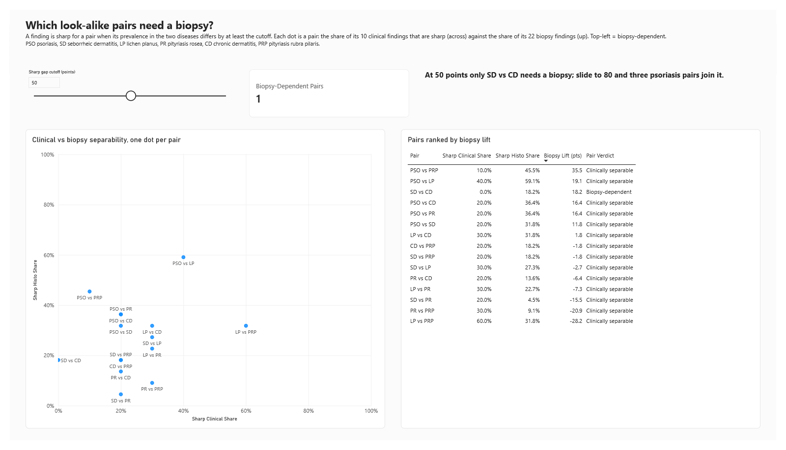

# When Does the Biopsy Earn Its Keep?

**Which of six look-alike skin diseases can be told apart from a clinical exam alone, and which need a biopsy?**

A data analyst portfolio project using **PostgreSQL** (pipeline + analysis), **Excel** (first-pass EDA and tie-out) and **Power BI** (report). It is framed as decision support for a dermatology clinic, or for an HMO reviewing when biopsies add the most value.

This project explains the data rather than predicting it. There is no machine-learning model.

---

## Headline findings

- **Only one disease pair truly needs the biopsy.** Seborrheic dermatitis and chronic dermatitis have no clinical finding that differs by 50+ points: the best is 15.7. Under the microscope they separate cleanly, because *fibrosis of the papillary dermis* is seen in 100% of chronic dermatitis patients and 0% of seborrheic dermatitis patients.
- **For psoriasis, the biopsy adds the most.** Psoriasis has near-perfect histopathological markers (thinning of the suprapapillary epidermis, clubbing of the rete ridges). Its best clinical clues (scalp, knee and elbow involvement) appear in about 80% of patients. If the bar for "sharp" rises to 80 points, three more psoriasis pairs become biopsy-dependent.
- **Seborrheic dermatitis vs pityriasis rosea is the hardest pair, and the biopsy helps least there.** Only 3 of 32 findings differ by 50+ points, and only 1 of those 3 is histopathological. Both diseases have the same top signature (spongiosis), and neither has a single "red flag" finding.

---

## The data

| | |
|---|---|
| Source | UCI Dermatology dataset (Ilter & Güvenir, 1998), via the Kaggle copy "Dermatology Dataset (Multi-class classification)" by olcaybolat1 |
| Rows | 366 patients, one row each (no patient ID in the file) |
| Findings | 10 clinical + 22 histopathological (from biopsy), each scored 0–3 |
| Other | Family history (0/1), age in years |
| Diagnosis | Psoriasis (112), Seborrheic dermatitis (61), Lichen planus (72), Pityriasis rosea (49), Chronic dermatitis (52), Pityriasis rubra pilaris (20) |

All six diseases share erythema and scaling, which is why they are hard to tell apart.

**Data quality findings** (from `sql/02_profiling.sql`):
- 8 missing ages coded `?`, 4 of them in chronic dermatitis.
- One psoriasis patient (row 120) has age 0. This is treated as missing, so 9 ages are unknown and the known ages run 7–75.
- `eosinophils_in_the_infiltrate` only ranges 0–2. That is real, not an error.
- No exact duplicate rows. All other findings are clean integers 0–3.

---

## Pipeline

```
data/dermatology.csv  →  staging (all TEXT)  →  clean (typed + constrained)  →  star schema  →  14 checks  →  analysis views
                          01_staging            03_clean                        04_model        05_validation  06_analysis_views
                          02_profiling (read-only)
```

| Script | What it does |
|---|---|
| `00_run_all.sql` | Runs everything in order and stops at the first error |
| `01_staging.sql` | Loads the CSV as text, mapped by column position, and keeps file order as `patient_id` |
| `02_profiling.sql` | Profiles every column: blanks, `?` codes, ranges, distinct values, missing ages by class, duplicates |
| `03_clean.sql` | Real types; a `finding_score` domain (0–3, NOT NULL); CHECK constraints. Bad data fails loudly |
| `04_model.sql` | Star schema: `dim_disease`, `dim_feature`, `patients`, `fact_findings` (11,712 rows = 366 × 32) |
| `05_validation.sql` | 14 PASS/FAIL checks (row counts, round trip to the raw CSV, class counts) plus an Excel tie-out grid |
| `06_analysis_views.sql` | 11 `vw_` views answering the five questions below |

**Star schema** (Power BI relationships): `dim_disease → patients → fact_findings ← dim_feature`

### Run it

Requires PostgreSQL 12+ (tested on 16 and 18) with `psql` on PATH. Run from the repo root:

```powershell
createdb -U postgres derm                          # first time only
psql -U postgres -d derm -f sql/00_run_all.sql
```

All 14 checks must say PASS. If any check fails, the script raises an error and exits non-zero.

**Independent check in Excel:** `excel/dermatology_eda.xlsx` recomputes the prevalence grid and the Q1 profile from the raw CSV using only Excel formulas (COUNTIFS, XLOOKUP, MEDIAN(IF)). All 224 prevalence cells match SQL exactly, and its `tieout` sheet says PASS. See [excel/BUILD_GUIDE.md](excel/BUILD_GUIDE.md).

**Power BI report:** open `powerbi/dermatology.pbip` in Power BI Desktop and click **Refresh** to load the data from the `derm` database. The report is saved as a Power BI Project, so it is plain text:
- the model (relationships and DAX measures) is TMDL in [`powerbi/dermatology.SemanticModel/`](powerbi/dermatology.SemanticModel/definition/);
- each page and visual is a JSON file in `powerbi/dermatology.Report/`.

See [powerbi/BUILD_GUIDE.md](powerbi/BUILD_GUIDE.md) for the model, the measures and the pages.

---

## Metric definitions

| Metric | Definition |
|---|---|
| **Prevalence** | % of patients in a group with a finding at score ≥ 1, i.e. `AVG(is_present)` |
| **Signature strength** | Prevalence in a disease minus prevalence among all *other* patients, in percentage points |
| **Gap** | For a disease pair, the absolute difference in a finding's prevalence |
| **Sharp** | Gap ≥ 50 points (a what-if parameter in Power BI) |
| **Red flag** | Among patients with a finding at score ≥ k, one disease makes up ≥ 80%, with at least 10 such patients |
| **Atypical** | Patient is missing at least one of their own disease's top 3 signature findings |

Prevalence is rounded to one decimal once, in the base view, and later numbers are built from it. This can be off by up to 0.1 point, in exchange for every number matching what is displayed.

---

## Questions, approach, findings

### 1. Who's in the data?
*View: `vw_q1_disease_profile`, `vw_q1_age_bands`. Power BI page: Overview*

`ROLLUP` adds an "All patients" total row, and `PERCENTILE_CONT(0.5)` gives the median age.

| Disease | Patients | % | Median age | Family history |
|---|---:|---:|---:|---:|
| Psoriasis | 112 | 30.6 | 39.5 | 28.6% |
| Lichen planus | 72 | 19.7 | 40.0 | 1.4% |
| Seborrheic dermatitis | 61 | 16.7 | 34.0 | 4.9% |
| Chronic dermatitis | 52 | 14.2 | 35.5 | 0.0% |
| Pityriasis rosea | 49 | 13.4 | 35.0 | 0.0% |
| Pityriasis rubra pilaris | 20 | 5.5 | 9.5 | 50.0% |
| **All patients** | **366** | **100** | **35.0** | **12.6%** |

Pityriasis rubra pilaris is a juvenile group in this sample (ages 7–22), and half of those patients have a family history. Missing ages are spread out, except that 4 of the 9 are chronic dermatitis patients.

### 2. What makes each disease distinctive, and which findings don't help?
*View: `vw_q2_signature_strength`, `vw_q2_non_discriminators`. Power BI page: Signature heatmap*

`RANK() OVER (PARTITION BY disease ORDER BY signature strength DESC)` ranks findings within each disease.

| Disease | Strongest signature | Strength (pts) |
|---|---|---:|
| Pityriasis rubra pilaris | Perifollicular parakeratosis | 99.7 |
| Chronic dermatitis | Fibrosis of the papillary dermis | 99.4 |
| Lichen planus | Vacuolisation of basal layer / Saw-tooth retes / Band-like infiltrate (tied) | 98.3 |
| Psoriasis | Thinning of the suprapapillary epidermis | 95.6 |
| Pityriasis rosea | Spongiosis | 58.0 |
| Seborrheic dermatitis | Spongiosis | 57.3 |

The rankings rediscover textbook markers: band-like infiltrate for lichen planus, rete ridge changes for psoriasis, follicular plugging for pityriasis rubra pilaris. Seborrheic dermatitis and pityriasis rosea have weak signatures, and their best one is the same finding.

**Non-discriminators** are findings with the smallest spread in prevalence across the six diseases: erythema (3.8 pts), inflammatory mononuclear infiltrate (5.2), acanthosis (8.2) and scaling (11.5). Each is present in roughly 90% or more of every disease, so they confirm "skin disease" but don't narrow it down.

### 3. Headline: which pairs can be told apart clinically, and which need a biopsy?
*View: `vw_q3_pair_feature_gaps` (480 rows), `vw_q3_pair_summary` (15 rows). Power BI page: Look-alike pairs*

A self-join of the prevalence view on itself gives 15 disease pairs × 32 findings. For each pair, the share of clinical findings (out of 10) and of histopathological findings (out of 22) with a sharp gap is normalized by group size, so histopathology isn't favoured just because it has more findings.

**Verdict rule:** a pair is *clinically separable* if at least one clinical finding is sharp. Otherwise it is *biopsy-dependent* if a histopathological finding is sharp, or *hard even with a biopsy* if none is.

| Pair | Sharp clinical | Sharp histo | Best clinical gap | Verdict at 50 pts |
|---|---:|---:|---:|---|
| SD vs CD | 0 / 10 | 4 / 22 | 15.7 | **Biopsy-dependent** |
| PSO vs PRP | 1 / 10 | 10 / 22 | 97.3 | Clinically separable (biopsy adds most) |
| PSO vs LP | 4 / 10 | 13 / 22 | 95.8 | Clinically separable |
| SD vs PR | 2 / 10 | 1 / 22 | 80.0 | Clinically separable (biopsy adds least) |
| *11 other pairs* | 2–6 / 10 | 2–8 / 22 | 72.9–100 | Clinically separable |

How the verdicts change with the cutoff:

| Sharp cutoff | Biopsy-dependent pairs |
|---|---|
| 50–70 pts | SD vs CD |
| 80 pts | + PSO vs SD, PSO vs PR, PSO vs CD |
| 90 pts | + PR vs CD; SD vs PR becomes "hard even with a biopsy" |

### 4. Which findings point almost entirely to one disease?
*View: `vw_q4_finding_disease_mix`, `vw_q4_red_flags`. Power BI page: Feature explorer*

| Threshold | Red flags | Clinical | Histopathological |
|---|---:|---:|---:|
| Score ≥ 1 (present) | 15 | 3 | 12 |
| Score ≥ 2 (moderate+) | 18 | 5 | 13 |

- Every red flag points to lichen planus, psoriasis, chronic dermatitis or pityriasis rubra pilaris. **None points to seborrheic dermatitis or pityriasis rosea.**
- Clinical red flags at score ≥ 1: polygonal papules and oral mucosal involvement (lichen planus, 100%), and scalp involvement (psoriasis, 87%).
- Raising the threshold to score ≥ 2 adds knee and elbow involvement (psoriasis, 85%), disappearance of the granular layer (psoriasis, 86%) and follicular papules (pityriasis rubra pilaris, 82%). A strong finding is more specific than a faint one.
- Sanity check: Munro microabscess points to psoriasis 97.5% of the time.

### 5. How many patients are atypical?
*View: `vw_q5_patient_typicality`, `vw_q5_atypical_by_disease`. Power BI page: Feature explorer*

**55 of 366 patients (15.0%)** are missing at least one of their disease's top 3 signature findings.

| Disease | Atypical | % |
|---|---:|---:|
| Seborrheic dermatitis | 21 / 61 | 34.4 |
| Chronic dermatitis | 13 / 52 | 25.0 |
| Pityriasis rosea | 11 / 49 | 22.4 |
| Psoriasis | 7 / 112 | 6.3 |
| Pityriasis rubra pilaris | 1 / 20 | 5.0 |
| Lichen planus | 2 / 72 | 2.8 |

The cutoff was tuned on the counts. A looser rule ("fewer than 2 of the top 3") flags only 2 patients, which shows how consistent the signatures are, but it gives too few patients to compare diseases.

---

## Limitations

- **Small, old, single-site sample:** 366 patients from one 1998 study in Turkey. The smallest group (pityriasis rubra pilaris) has 20 patients, so one patient moves its percentages by 5 points.
- **Not real-world rates:** Percentages describe this sample's mix, not real-world prevalence or diagnostic odds. **This is not a diagnostic tool.**
- **No time, place or cost:** There are no dates, locations or costs, so there is no trend analysis and no cost claims about biopsies.
- **Association, not cause:** Patterns in the findings show association, not cause.
- **Arbitrary cutoffs:** The thresholds (50-point gap, 80% red flag share, top-3 signatures) are judgment calls. Power BI exposes the gap cutoff as a slider, and the table in Q3 shows how much the verdict depends on it.
- **Presence only, mostly:** Prevalence counts any score ≥ 1 as present and ignores intensity. Only Q4's score ≥ 2 comparison uses intensity.

---

## Repo layout

```
README.md
CLAUDE.md               project notes and conventions
data/dermatology.csv    raw Kaggle download (never edited)
sql/                    00_run_all.sql + pipeline scripts 01-06
excel/                  EDA workbook + build guide
powerbi/
  dermatology.pbip            Power BI Project (open this)
  dermatology.SemanticModel/  model: tables, relationships, DAX (TMDL)
  dermatology.Report/         5 report pages, one JSON file per visual (PBIR)
  BUILD_GUIDE.md              model, DAX measures, page layout
docs/                   screenshots
```

<!-- TODO: add Power BI screenshots once the report is built, e.g.

-->

---

## Dataset credit

Ilter, N. & Guvenir, H. (1998). *Dermatology* [Dataset]. UCI Machine Learning Repository. https://doi.org/10.24432/C5FK5P

Accessed via the Kaggle copy "Dermatology Dataset (Multi-class classification)" by olcaybolat1. <!-- TODO: paste the Kaggle page URL -->

Licensed under [CC BY 4.0](https://creativecommons.org/licenses/by/4.0/).
